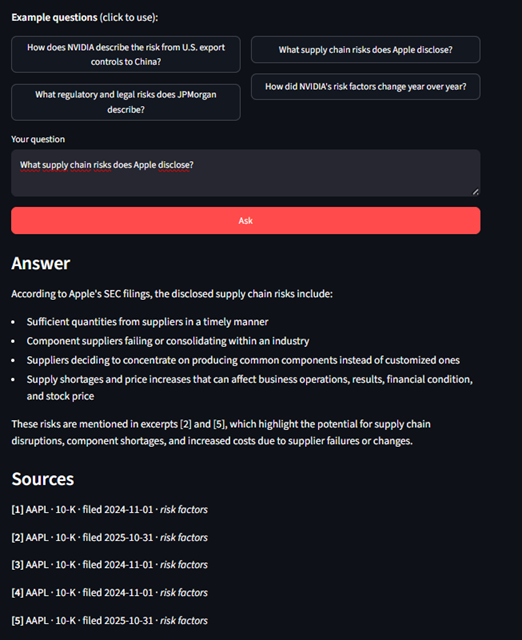
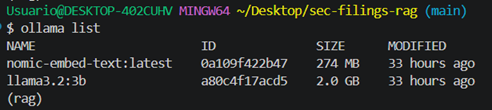
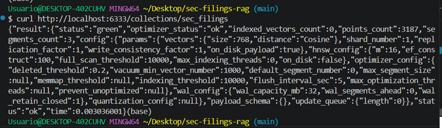
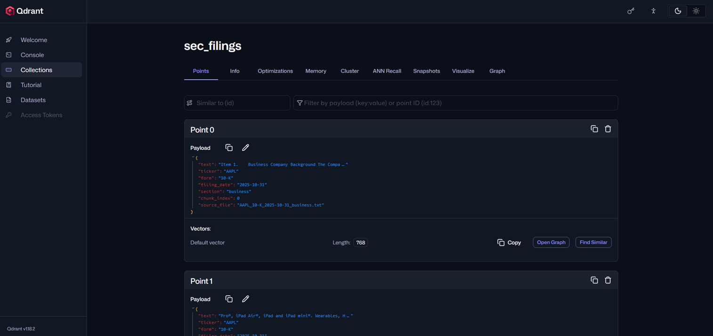
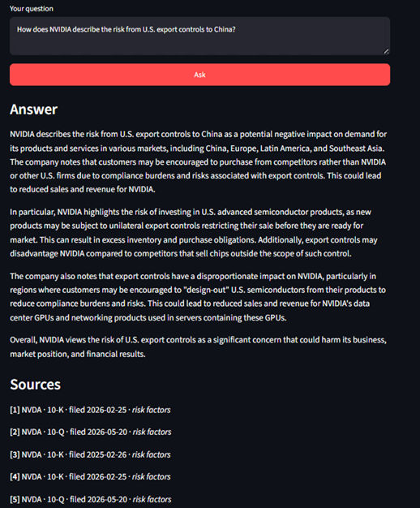
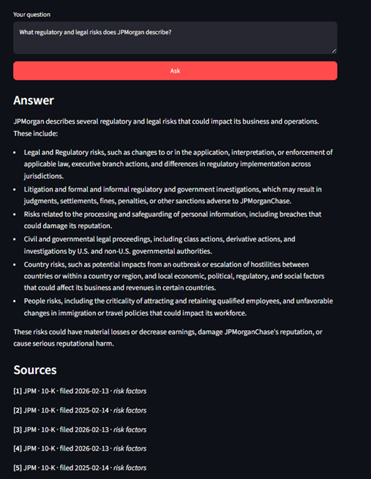
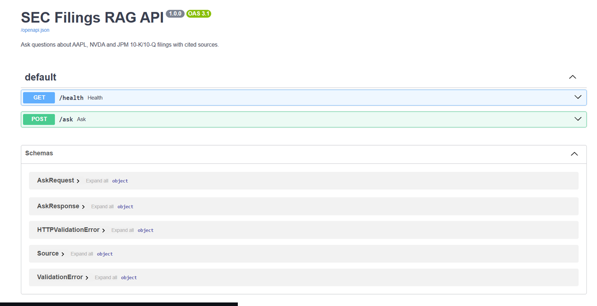
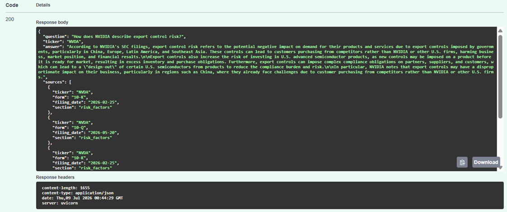
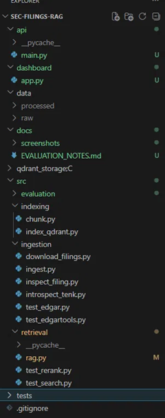

# SEC Filings RAG

[](https://github.com/DiegoTDDD/sec-filings-rag/actions/workflows/tests.yml)
[](LICENSE)


An end-to-end Retrieval-Augmented Generation (RAG) system that answers questions
about the SEC filings (10-K and 10-Q) of **Apple, NVIDIA and JPMorgan**, grounding
every answer in the source documents and citing the exact filing and section it
drew from.

Ask *"How does NVIDIA describe the risk from U.S. export controls to China?"* and
get a concise, prose answer built only from the filings — with the specific
10-K / 10-Q sections it used listed as sources.

**▶️ [Live demo](https://sec-filings-rag-demo.streamlit.app)** — a public, no-install version with precomputed answers. The fully interactive system runs locally (see [Running it](#running-it)).

The demo lives in a separate, lightweight repository, [sec-filings-rag-demo](https://github.com/DiegoTDDD/sec-filings-rag-demo), so the free host installs only `streamlit` instead of this project's full dependency set (about 150 pinned packages, including PyTorch). It holds copies of `dashboard/demo_app.py` and `dashboard/demo_data.json`; the answers are generated here by `src/retrieval/precompute_demo.py`. To refresh it, see [Refreshing the public demo](#refreshing-the-public-demo).



---

## Why this project

Analysts spend hours reading dense regulatory filings to answer narrow questions
("what supply-chain risks does this company disclose?", "how did its risk factors
change year over year?"). This system is a **regulatory-risk copilot**: it
retrieves the relevant passages from real SEC filings and generates an auditable
answer whose every claim can be traced back to a source section.

Because the domain is financial and regulatory, **faithfulness is a requirement,
not a nice-to-have** — the system is built to answer only from the filings and to
say when the answer isn't there, rather than hallucinate.

---

## Architecture

```
INGESTION      Fetch 10-K/10-Q from SEC EDGAR (edgartools) and extract clean
               Business / Risk Factors / MD&A text per filing.
                     │
INDEXING       Sentence-aware chunking (NLTK) → embeddings (nomic-embed-text via
               Ollama) → Qdrant vector store with per-chunk metadata.
                     │
RETRIEVAL      Hybrid search: dense (Qdrant) + BM25 keywords, fused with RRF
               (optionally filtered by company) → cross-encoder re-ranking
               (ms-marco-MiniLM) → top-k passages.
                     │
GENERATION     Grounded prompt over the top passages → llama3.2 (via Ollama) →
               prose answer + traceable sources.
                     │
EVALUATION     57-question set, retrieval strategy comparison and RAGAS
               (all four metrics) with a separate local judge, on GitHub Actions.
                     │
SERVING        FastAPI service (/ask, /health) + Streamlit dashboard.
```

---

## Tech stack

| Layer | Choice |
|---|---|
| Filings source | SEC EDGAR via `edgartools` |
| Embeddings | `nomic-embed-text` (Ollama, local, 768-dim) |
| Vector store | Qdrant (Docker), cosine distance, metadata filtering |
| Re-ranking | `cross-encoder/ms-marco-MiniLM-L-6-v2` |
| Generation LLM | `llama3.2:3b` (Ollama, local) — swappable for a hosted API via env vars |
| Evaluation | RAGAS (local judge) |
| API | FastAPI + Uvicorn |
| UI | Streamlit |

Both models run locally through Ollama:



The generation LLM is **provider-decoupled**: it defaults to a local Ollama model
but points to any OpenAI-compatible API by setting `LLM_BASE_URL` / `LLM_MODEL`.

---

## Indexing: chunking, embeddings and the vector store

Each filing section is split into sentence-aware chunks (so a chunk never cuts a
sentence mid-thought), embedded with `nomic-embed-text`, and stored in Qdrant with
its provenance metadata (ticker, form, filing date, section). For the default
three-company corpus this produces roughly **3,187 vectors**.



Qdrant runs as a Docker service; its web UI shows the stored points with their
768-dimension vectors and metadata payloads:



---

## Retrieval + re-ranking

Dense (bi-encoder) search embeds the question and each chunk independently — fast
but coarse. A cross-encoder instead reads the *(question, chunk)* pair together
and scores relevance directly — more accurate, but too slow to run over the whole
collection. So the pipeline retrieves a wide shortlist first, then
re-ranks that shortlist with the cross-encoder and keeps the best few. In practice
the dense scores cluster tightly (~0.78–0.80), while the cross-encoder separates
the candidates more decisively, promoting the passages that most directly answer
the question.

**Hybrid retrieval.** The shortlist is built from two searches: dense vectors
(good with paraphrases) and BM25 keywords (good with exact terms such as "CET1"
or a product name), merged with Reciprocal Rank Fusion before re-ranking. The
evaluation below shows why. `RETRIEVAL_MODE=dense` switches back to dense only.

**Company metadata filtering.** When a question targets one company, Qdrant
restricts retrieval to that company's chunks — so a high-volume filer (JPM) never
crowds out a company-specific question. The dashboard exposes this as a filter:



The same grounding works across all three companies, e.g. JPMorgan:



---

## Serving: API and dashboard

The pipeline is exposed as a **FastAPI** service (`/ask`, `/health`) with
auto-generated OpenAPI docs:



Each `/ask` call returns the grounded answer plus the source chunks used, with an
optional `ticker` filter:



The **Streamlit** dashboard is a thin UI over that API — company filter, example
questions, and answers with cited sources (shown at the top of this README).

---

## Evaluation

The whole evaluation runs on GitHub Actions with local models only (no API keys,
no cost): [`rag-eval.yml`](.github/workflows/rag-eval.yml) builds the index on a
runner, writes the question set, compares retrieval strategies, answers every
question and scores the answers with RAGAS on six runners in parallel. It runs on
demand and once a month; the last run took about 2.5 hours.

**Question set.** 57 questions: the 6 original hand-written questions plus 51
generated from the indexed chunks by `llama3.2:3b` (stratified across company,
form and section; questions that leak the setup, such as "according to the
excerpt", or that do not name the company are discarded). Each generated question
comes from one known chunk, which makes retrieval measurable exactly.

### Retrieval: why the pipeline is hybrid

| Strategy | hit@5 | MRR@5 | recall@20 |
|---|---|---|---|
| Dense (nomic-embed-text) | 0.47 | 0.28 | 0.76 |
| BM25 keyword | 0.92 | 0.63 | 0.98 |
| Hybrid (dense + BM25, RRF) | 0.78 | 0.48 | 0.96 |
| Dense + re-rank (previous pipeline) | 0.73 | 0.52 | 0.76 |
| **Hybrid + re-rank (current pipeline)** | **0.80** | **0.56** | **0.96** |

*hit@5: the chunk the question was written from is among the 5 chunks given to the
LLM. recall@20: it is in the 20-candidate shortlist before re-ranking. Full table
in [`eval/retrieval_results.md`](eval/retrieval_results.md).*

Dense search alone left the source chunk out of the shortlist for about a quarter
of the questions, and the re-ranker cannot recover a chunk it never sees. Adding
BM25 with Reciprocal Rank Fusion raised recall@20 from 0.76 to 0.96, so the
pipeline now retrieves with both. BM25 alone scored highest, but that number is
optimistic: a question written from a chunk reuses its wording, which favours
keyword search, while real users paraphrase. Hybrid keeps dense search for those.

### Answers: RAGAS with a local judge

| Questions | n | Faithfulness | Answer relevancy | Context precision | Context recall |
|---|---|---|---|---|---|
| All | 57 | 0.81 | 0.46 | 0.72 | 0.92 |
| Hand-written | 6 | 0.99 | 0.73 | 0.98 | 0.91 |
| Generated | 51 | 0.79 | 0.43 | 0.69 | 0.92 |

*Answers by `llama3.2:3b`, judged by `qwen2.5:7b`, a larger model than the one
being graded. All 57 questions received all four scores. Per-question scores are in
the `rag-eval-report` artifact of each run.*

- **Faithfulness 0.81** and **context recall 0.92**: answers mostly stay within
  the retrieved text, and the retrieved text covers the reference answers.
- **Answer relevancy 0.46** is the weak point. The metric rewards answers that
  address the question directly; a 3B generator often answers partially or says
  the context is insufficient, which this metric scores low. A stronger generator
  is the next lever, and the harness measures the effect of swapping it.
- An earlier version of this table, judged by the same 3B model that wrote the
  answers, reported answer relevancy 0.95 on the 6 hand-written questions and
  could not complete faithfulness or context precision: RAGAS sent 16 judge calls
  at once with a 180-second limit, and the local server queued them until they
  timed out. With 2 calls at a time and a separate judge, all metrics complete;
  the self-graded 0.95 was optimistic.

---

## Running it

The pipeline depends on three local services: **Qdrant** (vector store, in Docker),
**Ollama** (embeddings + generation LLM), and the **FastAPI** app. Bring them up in
order. Commands assume a `bash`-style shell.

### 1. Prerequisites
- Python 3.11.5 or a newer 3.11 release (conda recommended; `soupsieve` 4 needs 3.11.5+)
- Docker (for Qdrant)
- [Ollama](https://ollama.com) installed and running, with the models pulled:
  ```bash
  ollama pull nomic-embed-text
  ollama pull llama3.2:3b
  ```
- Platform: developed on Windows. The pinned `requirements.txt` resolves on Windows and Linux. On macOS it needs an Apple Silicon Mac with macOS 14 or newer, because the pinned PyTorch has no wheels for Intel Macs.

### 2. Environment
```bash
conda create -n rag python=3.11 -y
conda activate rag
pip install -r requirements.txt
```
> On newer conda you may first need to accept channel terms of service:
> `conda tos accept --override-channels --channel https://repo.anaconda.com/pkgs/main`
> (repeat for the `/pkgs/r` and `/pkgs/msys2` channels). See **Troubleshooting**
> if outbound HTTPS or RAGAS imports fail.

### 3. Start the vector store
```bash
docker run -d --name qdrant -p 127.0.0.1:6333:6333 -p 127.0.0.1:6334:6334 \
  -v "$(pwd)/qdrant_storage:/qdrant/storage" qdrant/qdrant
```
The `$(pwd)` syntax is for bash / Git Bash / macOS / Linux. On Windows
**PowerShell** use `-v "${PWD}/qdrant_storage:/qdrant/storage"`, and on **CMD**
use `-v "%cd%/qdrant_storage:/qdrant/storage"`.
(If the container already exists from a previous run, use `docker start qdrant`.)

### 4. Ingest filings and build the index
Make sure **Ollama is running** (embeddings are generated locally) before this step.
```bash
python src/ingestion/ingest.py        # download filings + extract clean sections
python src/indexing/chunk.py          # sentence-aware chunking (downloads NLTK punkt on first run)
python src/indexing/index_qdrant.py   # embed chunks + load into Qdrant
```

### 5. Serve the API and dashboard
```bash
# Terminal 1 — API (needs Qdrant + Ollama up)
uvicorn api.main:app --port 8000

# Terminal 2 — dashboard (needs the API up)
streamlit run dashboard/app.py
```
The dashboard opens at `http://localhost:8501`; the API docs at
`http://localhost:8000/docs`.

### Ask from the CLI (alternative to the dashboard)
```bash
python src/retrieval/rag.py "How does NVIDIA describe export control risk?"
```

### (Optional) evaluate with RAGAS

RAGAS is deliberately **not** in `requirements.txt`. Its latest release (and `diskcache`,
which it pulls in) have open security advisories with no patched version
(GHSA-95ww-475f-pr4f and GHSA-w8v5-vhqr-4h9v), so a normal install does not ship them.
Install it only when you want to run the evaluation, in the same environment. It adds
`ragas` and `diskcache` and does not change any other pinned version:

```bash
pip install ragas==0.3.9
ollama pull qwen2.5:7b                           # the judge
python src/evaluation/build_eval_set.py          # synthetic questions -> eval/eval_set.json
python src/evaluation/retrieval_eval.py          # retrieval comparison
python src/evaluation/generate_answers.py        # RAG answers -> eval/answers.json
python src/evaluation/evaluate_ragas.py          # RAGAS scores (add --shard i --shards n to split)
python src/evaluation/merge_ragas.py             # one table
```
On a laptop CPU the judging step takes several hours; the GitHub workflow splits it
across six runners.

If `import ragas` fails with `No module named 'langchain_community.chat_models.vertexai'`,
run `python src/evaluation/fix_ragas_import.py` once (see Troubleshooting).

### Running the tests

The unit tests do not need Qdrant, Ollama or the full dependency set:
```bash
pip install -r requirements-test.txt
pytest
```
The scripts in `scripts/checks/` are manual diagnostics that talk to the live services (EDGAR, Qdrant, Ollama); run them from the project root, for example `python scripts/checks/compare_rerank.py "your question"`.

### Refreshing the public demo

The [public demo](https://sec-filings-rag-demo.streamlit.app) serves the answers saved in `dashboard/demo_data.json`. To regenerate them:

1. Start Qdrant and Ollama, and make sure the index is built (steps 3 and 4 above).
2. Optional: edit the `DEMO_QUESTIONS` list in `src/retrieval/precompute_demo.py` to change the questions.
3. Run `python src/retrieval/precompute_demo.py` in the project environment (see Troubleshooting if `SSL_CERT_FILE` errors on conda for Windows). It writes `dashboard/demo_data.json`.
4. Copy `dashboard/demo_app.py` and `dashboard/demo_data.json` to the root of the [sec-filings-rag-demo](https://github.com/DiegoTDDD/sec-filings-rag-demo) repository (both files must sit in the same folder), then commit and push. Streamlit Community Cloud redeploys the app when its branch is updated.

---

## Project structure

```
sec-filings-rag/
├── api/                 FastAPI service (/ask, /health)
├── dashboard/           Streamlit UI
├── src/
│   ├── ingestion/       EDGAR download + section extraction
│   ├── indexing/        chunking + embeddings + Qdrant load
│   ├── retrieval/       hybrid search (dense + BM25) + re-rank + RAG pipeline
│   └── evaluation/      question set, retrieval comparison, RAGAS harness
├── eval/                question sets and the latest evaluation results
├── tests/               unit tests (pytest), external services mocked
├── scripts/checks/      manual diagnostics against live EDGAR / Qdrant / Ollama
├── docs/screenshots/    case-study images
├── data/                raw + processed filings (gitignored)
├── .github/             CI: tests, demo sync, dependency check, security audit
├── pyproject.toml       project metadata, pytest and ruff settings
├── requirements.txt     pinned versions of everything
└── requirements-test.txt  light set for the unit tests
```



---

## Troubleshooting

Environment-specific issues you may hit depending on your OS / package versions:

- **`FileNotFoundError` for `SSL_CERT_FILE` (conda on Windows).** Some conda setups
  point `SSL_CERT_FILE` at a certificate bundle that isn't present, which breaks
  outbound HTTPS (e.g. `edgartools`). Point it at the installed `certifi` bundle:
  ```bash
  export SSL_CERT_FILE="$(python -c 'import certifi; print(certifi.where())')"
  ```
- **RAGAS import error: `No module named 'langchain_community.chat_models.vertexai'`** (after
  `pip install ragas==0.3.9`).
  Modern `langchain-community` removed that path while RAGAS still imports from it.
  Since this project uses a local judge (not Vertex AI), the fix is to provide a
  small stub so the import resolves; see `src/evaluation/fix_ragas_import.py`.

---

## Limitations & future work

- **Small generator.** `llama3.2:3b` keeps everything free and local, and it is
  the main reason answer relevancy is 0.46. A larger model (local or via the
  existing API settings) is the next step, measured by the same evaluation.
- **Synthetic questions.** Generated questions reuse their source chunk's wording,
  which flatters keyword search; a larger hand-written set would complement them.
- **Table-heavy content.** Ingestion focuses on narrative sections (Risk Factors,
  MD&A, Business); parsing dense financial tables is future work.
- **Corpus size.** Three companies × recent filings by design (quality over
  quantity); the ingestion is parameterized by ticker and scales horizontally.
- **Deployment.** The system runs locally against Qdrant + Ollama. The public
  demo serves precomputed answers; a fully interactive hosted version would swap
  the local LLM for an API using the existing env-var configuration.

---

## Automated checks

- **RAG evaluation** (`rag-eval.yml`) runs on demand and monthly: full index on a runner, synthetic question set, retrieval comparison and RAGAS scoring across six runners, all with local models (see [Evaluation](#evaluation)).
- **Tests** (`tests.yml`) runs on every push and pull request: `ruff` lint plus 42 unit tests covering sentence-aware chunking (size limit, overlap, no lost sentences), ingestion (file naming, skipping cross-reference stubs), the RAG pipeline (ticker filter, hybrid fusion, re-rank order, grounded prompt, empty-retrieval handling), the evaluation code (question filtering, retrieval metrics, sharding, merging) and the API (`/health`, `/ask`, ticker normalization, validation). Qdrant, Ollama, the LLM and PyTorch are replaced by stand-ins, so the job needs only `requirements-test.txt`. A second job checks that the public demo repository holds the same `demo_app.py` and `demo_data.json` as `dashboard/`, so the live demo cannot drift from this project unnoticed.
- **Dependency check** (`deps-check.yml`) installs `requirements.txt` from scratch on Linux, Windows and Apple Silicon macOS whenever it changes, runs `pip check`, checks that Streamlit renders images with this Pillow, imports the key libraries, compiles the source, checks sentence splitting and loads the re-ranking model. On Linux it also runs README steps 3 and 5: it starts the Qdrant container with the exact command shown there, then starts the API (`/health`, `/docs`) and the dashboard. Step 4 (ingestion and indexing) needs Ollama and the SEC servers, so it is not run in CI.
- **Security audit** (`security-audit.yml`) audits `requirements.txt` with `pip-audit` whenever it changes and every Monday. It fails only when a vulnerable package has a fixed version available.

---

## Author

**Diego Leonardo Alves de Andrade** — [github.com/DiegoTDDD](https://github.com/DiegoTDDD)
