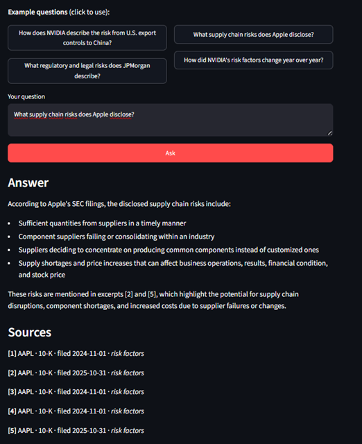
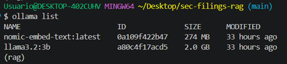
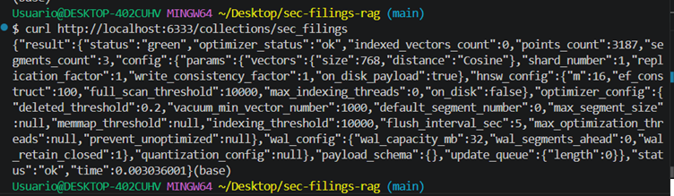
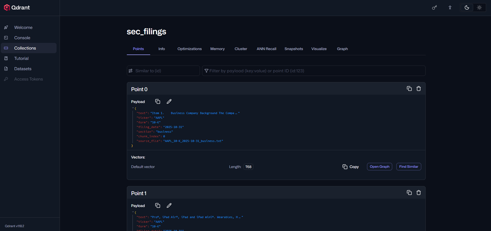
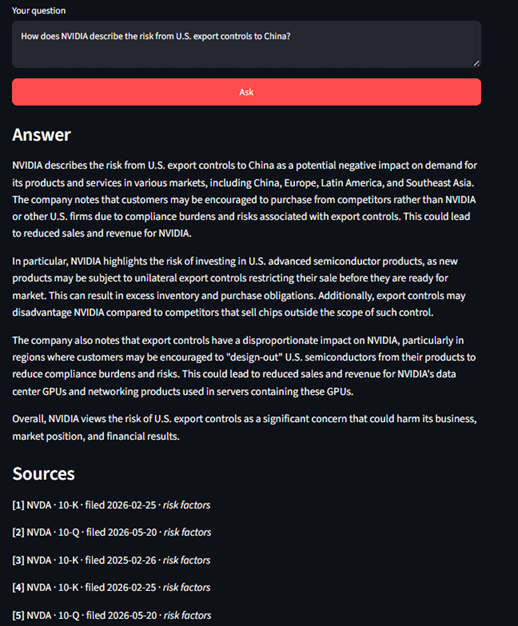
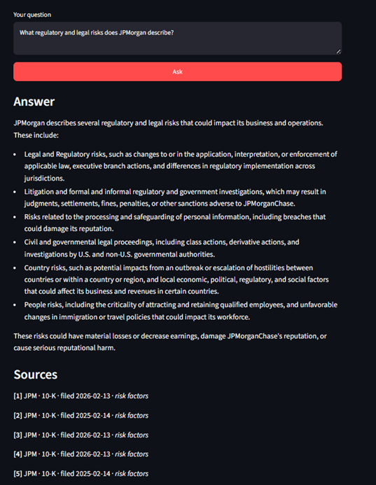
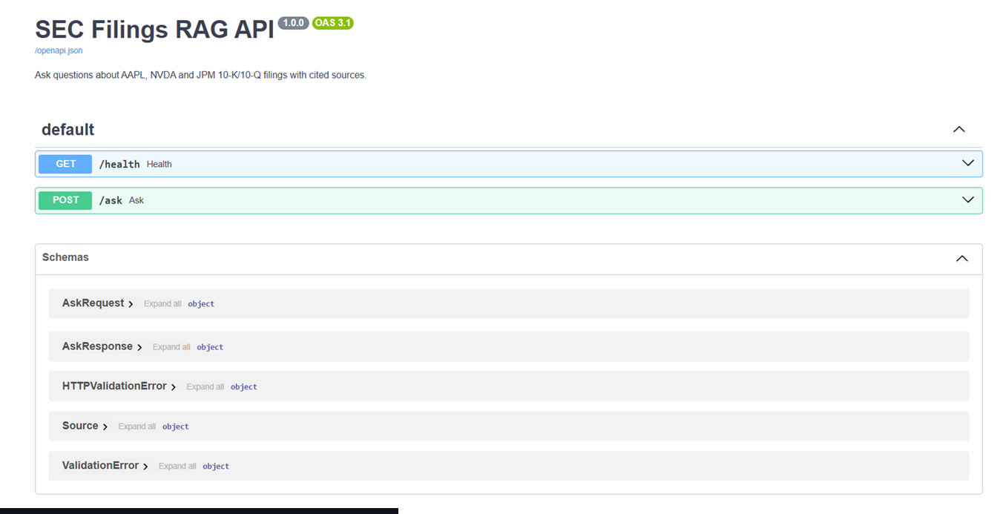
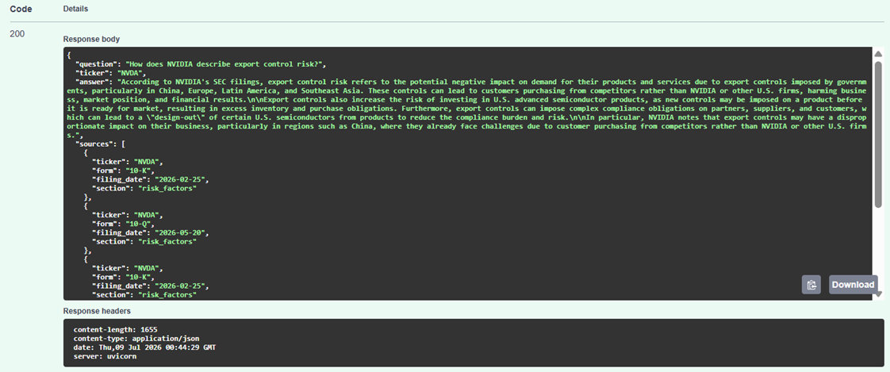
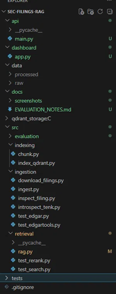

# SEC Filings RAG

An end-to-end Retrieval-Augmented Generation (RAG) system that answers questions
about the SEC filings (10-K and 10-Q) of **Apple, NVIDIA and JPMorgan**, grounding
every answer in the source documents and citing the exact filing and section it
drew from.

Ask *"How does NVIDIA describe the risk from U.S. export controls to China?"* and
get a concise, prose answer built only from the filings — with the specific
10-K / 10-Q sections it used listed as sources.

**▶️ [Live demo](https://sec-filings-rag-demo.streamlit.app)** — a public, no-install version with precomputed answers. The fully interactive system runs locally (see [Running it](#running-it)).

The demo lives in a separate, lightweight repository, [sec-filings-rag-demo](https://github.com/DiegoTDDD/sec-filings-rag-demo), so the free host installs only `streamlit` instead of this project's full dependency set (about 150 pinned packages, including PyTorch). It holds copies of `dashboard/demo_app.py` and `dashboard/demo_data.json`; the answers are generated here by `src/retrieval/precompute_demo.py`. To refresh it, see [Refreshing the public demo](#refreshing-the-public-demo).



---

## Why this project

Analysts spend hours reading dense regulatory filings to answer narrow questions
("what supply-chain risks does this company disclose?", "how did its risk factors
change year over year?"). This system is a **regulatory-risk copilot**: it
retrieves the relevant passages from real SEC filings and generates an auditable
answer whose every claim can be traced back to a source section.

Because the domain is financial and regulatory, **faithfulness is a requirement,
not a nice-to-have** — the system is built to answer only from the filings and to
say when the answer isn't there, rather than hallucinate.

---

## Architecture

```
INGESTION      Fetch 10-K/10-Q from SEC EDGAR (edgartools) and extract clean
               Business / Risk Factors / MD&A text per filing.
                     │
INDEXING       Sentence-aware chunking (NLTK) → embeddings (nomic-embed-text via
               Ollama) → Qdrant vector store with per-chunk metadata.
                     │
RETRIEVAL      Dense search in Qdrant (optionally filtered by company) →
               cross-encoder re-ranking (ms-marco-MiniLM) → top-k passages.
                     │
GENERATION     Grounded prompt over the top passages → llama3.2 (via Ollama) →
               prose answer + traceable sources.
                     │
EVALUATION     RAGAS metrics (faithfulness, answer relevancy, context
               precision/recall) with a local judge model.
                     │
SERVING        FastAPI service (/ask, /health) + Streamlit dashboard.
```

---

## Tech stack

| Layer | Choice |
|---|---|
| Filings source | SEC EDGAR via `edgartools` |
| Embeddings | `nomic-embed-text` (Ollama, local, 768-dim) |
| Vector store | Qdrant (Docker), cosine distance, metadata filtering |
| Re-ranking | `cross-encoder/ms-marco-MiniLM-L-6-v2` |
| Generation LLM | `llama3.2:3b` (Ollama, local) — swappable for a hosted API via env vars |
| Evaluation | RAGAS (local judge) |
| API | FastAPI + Uvicorn |
| UI | Streamlit |

Both models run locally through Ollama:



The generation LLM is **provider-decoupled**: it defaults to a local Ollama model
but points to any OpenAI-compatible API by setting `LLM_BASE_URL` / `LLM_MODEL`.

---

## Indexing: chunking, embeddings and the vector store

Each filing section is split into sentence-aware chunks (so a chunk never cuts a
sentence mid-thought), embedded with `nomic-embed-text`, and stored in Qdrant with
its provenance metadata (ticker, form, filing date, section). For the default
three-company corpus this produces roughly **3,187 vectors**.



Qdrant runs as a Docker service; its web UI shows the stored points with their
768-dimension vectors and metadata payloads:



---

## Retrieval + re-ranking

Dense (bi-encoder) search embeds the question and each chunk independently — fast
but coarse. A cross-encoder instead reads the *(question, chunk)* pair together
and scores relevance directly — more accurate, but too slow to run over the whole
collection. So the pipeline retrieves a wide shortlist with dense search, then
re-ranks that shortlist with the cross-encoder and keeps the best few. In practice
the dense scores cluster tightly (~0.78–0.80), while the cross-encoder separates
the candidates more decisively, promoting the passages that most directly answer
the question.

**Company metadata filtering.** When a question targets one company, Qdrant
restricts retrieval to that company's chunks — so a high-volume filer (JPM) never
crowds out a company-specific question. The dashboard exposes this as a filter:



The same grounding works across all three companies, e.g. JPMorgan:



---

## Serving: API and dashboard

The pipeline is exposed as a **FastAPI** service (`/ask`, `/health`) with
auto-generated OpenAPI docs:



Each `/ask` call returns the grounded answer plus the source chunks used, with an
optional `ticker` filter:



The **Streamlit** dashboard is a thin UI over that API — company filter, example
questions, and answers with cited sources (shown at the top of this README).

---

## Evaluation

Evaluated with **RAGAS** over 6 curated questions spanning all three companies and
multiple sections, using a **local `llama3.2:3b` judge** (no external API).

| Metric | Score |
|---|---|
| Answer relevancy | **0.95** |
| Context recall | **0.67** |
| Faithfulness | n/a (local judge timed out) |
| Context precision | n/a (local judge timed out) |

**Documented limitation.** Faithfulness and context precision require the judge to
decompose each answer into claims and verify them against the context — many
reasoning steps per question. The local 3B judge timed out on these while
completing the lighter metrics. This is a limitation of the *evaluator*, not the
pipeline: the harness is judge-agnostic, so re-running with a frontier-class judge
(e.g. GPT-4-class) would be a configuration change and would be expected to
complete all four metrics with more stable, discriminative scores. The reported
numbers are directional evidence that retrieval and generation work well.

---

## Running it

The pipeline depends on three local services: **Qdrant** (vector store, in Docker),
**Ollama** (embeddings + generation LLM), and the **FastAPI** app. Bring them up in
order. Commands assume a `bash`-style shell.

### 1. Prerequisites
- Python 3.11 (conda recommended)
- Docker (for Qdrant)
- [Ollama](https://ollama.com) installed and running, with the models pulled:
  ```bash
  ollama pull nomic-embed-text
  ollama pull llama3.2:3b
  ```
- Platform: developed on Windows. The pinned `requirements.txt` resolves on Windows and Linux. On macOS it needs an Apple Silicon Mac with macOS 14 or newer, because the pinned PyTorch has no wheels for Intel Macs.

### 2. Environment
```bash
conda create -n rag python=3.11 -y
conda activate rag
pip install -r requirements.txt
```
> On newer conda you may first need to accept channel terms of service:
> `conda tos accept --override-channels --channel https://repo.anaconda.com/pkgs/main`
> (repeat for the `/pkgs/r` and `/pkgs/msys2` channels). See **Troubleshooting**
> if outbound HTTPS or RAGAS imports fail.

### 3. Start the vector store
```bash
docker run -d --name qdrant -p 127.0.0.1:6333:6333 -p 127.0.0.1:6334:6334 \
  -v "$(pwd)/qdrant_storage:/qdrant/storage" qdrant/qdrant
```
The `$(pwd)` syntax is for bash / Git Bash / macOS / Linux. On Windows
**PowerShell** use `-v "${PWD}/qdrant_storage:/qdrant/storage"`, and on **CMD**
use `-v "%cd%/qdrant_storage:/qdrant/storage"`.
(If the container already exists from a previous run, use `docker start qdrant`.)

### 4. Ingest filings and build the index
Make sure **Ollama is running** (embeddings are generated locally) before this step.
```bash
python src/ingestion/ingest.py        # download filings + extract clean sections
python src/indexing/chunk.py          # sentence-aware chunking (downloads NLTK punkt on first run)
python src/indexing/index_qdrant.py   # embed chunks + load into Qdrant
```

### 5. Serve the API and dashboard
```bash
# Terminal 1 — API (needs Qdrant + Ollama up)
uvicorn api.main:app --port 8000

# Terminal 2 — dashboard (needs the API up)
streamlit run dashboard/app.py
```
The dashboard opens at `http://localhost:8501`; the API docs at
`http://localhost:8000/docs`.

### Ask from the CLI (alternative to the dashboard)
```bash
python src/retrieval/rag.py "How does NVIDIA describe export control risk?"
```

### (Optional) evaluate with RAGAS

RAGAS is deliberately **not** in `requirements.txt`. Its latest release (and `diskcache`,
which it pulls in) have open security advisories with no patched version
(GHSA-95ww-475f-pr4f and GHSA-w8v5-vhqr-4h9v), so a normal install does not ship them.
Install it only when you want to run the evaluation, in the same environment. It adds
`ragas` and `diskcache` and does not change any other pinned version:

```bash
pip install ragas==0.3.9
python src/evaluation/evaluate_ragas.py
```

If `import ragas` fails with `No module named 'langchain_community.chat_models.vertexai'`,
run `python src/evaluation/fix_ragas_import.py` once (see Troubleshooting).

### Refreshing the public demo

The [public demo](https://sec-filings-rag-demo.streamlit.app) serves the answers saved in `dashboard/demo_data.json`. To regenerate them:

1. Start Qdrant and Ollama, and make sure the index is built (steps 3 and 4 above).
2. Optional: edit the `DEMO_QUESTIONS` list in `src/retrieval/precompute_demo.py` to change the questions.
3. Run `python src/retrieval/precompute_demo.py` in the project environment (see Troubleshooting if `SSL_CERT_FILE` errors on conda for Windows). It writes `dashboard/demo_data.json`.
4. Copy `dashboard/demo_app.py` and `dashboard/demo_data.json` to the root of the [sec-filings-rag-demo](https://github.com/DiegoTDDD/sec-filings-rag-demo) repository (both files must sit in the same folder), then commit and push. Streamlit Community Cloud redeploys the app when its branch is updated.

---

## Project structure

```
sec-filings-rag/
├── api/                 FastAPI service (/ask, /health)
├── dashboard/           Streamlit UI
├── src/
│   ├── ingestion/       EDGAR download + section extraction
│   ├── indexing/        chunking + embeddings + Qdrant load
│   ├── retrieval/       dense search + re-rank + RAG pipeline
│   └── evaluation/      RAGAS harness
├── docs/screenshots/    case-study images
├── data/                raw + processed filings (gitignored)
├── .github/             CI: dependency check, security audit
└── requirements.txt     pinned versions of everything
```



---

## Troubleshooting

Environment-specific issues you may hit depending on your OS / package versions:

- **`FileNotFoundError` for `SSL_CERT_FILE` (conda on Windows).** Some conda setups
  point `SSL_CERT_FILE` at a certificate bundle that isn't present, which breaks
  outbound HTTPS (e.g. `edgartools`). Point it at the installed `certifi` bundle:
  ```bash
  export SSL_CERT_FILE="$(python -c 'import certifi; print(certifi.where())')"
  ```
- **RAGAS import error: `No module named 'langchain_community.chat_models.vertexai'`** (after
  `pip install ragas==0.3.9`).
  Modern `langchain-community` removed that path while RAGAS still imports from it.
  Since this project uses a local judge (not Vertex AI), the fix is to provide a
  small stub so the import resolves; see `src/evaluation/fix_ragas_import.py`.

---

## Limitations & future work

- **Local judge for evaluation.** A stronger judge would complete all RAGAS
  metrics; the harness already supports swapping it.
- **Table-heavy content.** Ingestion focuses on narrative sections (Risk Factors,
  MD&A, Business); parsing dense financial tables is future work.
- **Corpus size.** Three companies × recent filings by design (quality over
  quantity); the ingestion is parameterized by ticker and scales horizontally.
- **Deployment.** The system runs locally against Qdrant + Ollama. The public
  demo serves precomputed answers; a fully interactive hosted version would swap
  the local LLM for an API using the existing env-var configuration.

---

## Automated checks

- **Dependency check** (`deps-check.yml`) installs `requirements.txt` from scratch on Linux, Windows and Apple Silicon macOS whenever it changes, runs `pip check`, checks that Streamlit renders images with this Pillow, imports the key libraries, compiles the source, checks sentence splitting and loads the re-ranking model. On Linux it also runs README steps 3 and 5: it starts the Qdrant container with the exact command shown there, then starts the API (`/health`, `/docs`) and the dashboard. Step 4 (ingestion and indexing) needs Ollama and the SEC servers, so it is not run in CI.
- **Security audit** (`security-audit.yml`) audits `requirements.txt` with `pip-audit` whenever it changes and every Monday. It fails only when a vulnerable package has a fixed version available.

---

## Author

**Diego Leonardo Alves de Andrade** — [github.com/DiegoTDDD](https://github.com/DiegoTDDD)
